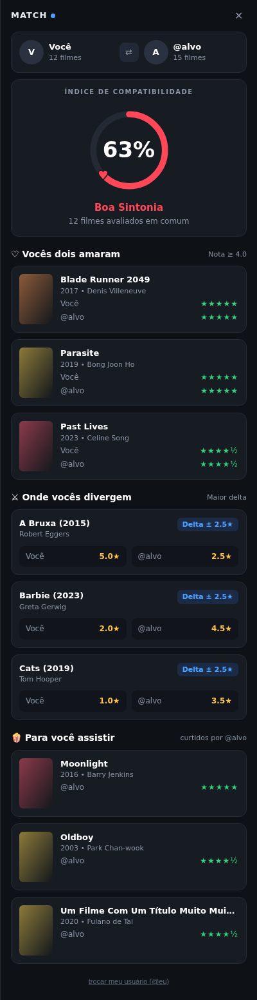

# Letterboxd Match 🎬

Extensão de navegador **não oficial** que mostra o quanto o seu gosto de filmes combina com o de outra pessoa no [Letterboxd](https://letterboxd.com).

  
   
  Imagem com dados de exemplo.

> **Aviso:** este é um projeto independente. Não tem ligação com o Letterboxd nem é aprovado por eles. Letterboxd é uma marca dos seus donos.

## O que ela faz

Em qualquer perfil do Letterboxd, aparece um botão **🎬 Dar match**. Ao clicar, abre um painel lateral com:

- **Índice de compatibilidade:** de 0% a 100%, com base nas notas que vocês deram para os mesmos filmes.
- **Vocês dois amaram:** filmes em que os dois deram 4★ ou mais.
- **Onde vocês divergem:** filmes em que as notas mais se distanciam.
- **Para você assistir:** filmes que a outra pessoa curtiu (4★ ou mais) e que você ainda não viu.

## Instalação (Chrome, Edge, Brave e Opera)

1. Baixe o `.zip` mais recente na página de [Releases](../../releases) e extraia.
2. Abra a página de extensões do navegador:
   - Chrome: `chrome://extensions`
   - Edge: `edge://extensions`
   - Brave: `brave://extensions`
   - Opera / Opera GX: `opera://extensions`
3. Ative o **Modo do desenvolvedor**.
4. Clique em **Carregar sem compactação** e escolha a pasta `letterboxd-match` (a que tem o arquivo `manifest.json` dentro).

> Ainda não foi testada no Firefox.

## Como usar

1. Abra o perfil de outra pessoa em `letterboxd.com/usuario/`.
2. Clique em **🎬 Dar match**, no canto inferior direito.
3. Na primeira vez, digite o seu usuário do Letterboxd (o que aparece na URL do seu perfil).
4. Pronto! Para fechar o painel, use o ✕ ou a tecla **Esc**.

## Como a porcentagem é calculada

1. A extensão pega os filmes que **os dois assistiram e avaliaram**.
2. Calcula a diferença entre as duas notas em cada filme.
3. Faz a média dessas diferenças e converte em porcentagem:

| Diferença média | Compatibilidade |
|---|---|
| 0 estrelas | 100% |
| 1 estrela | 50% |
| 2 estrelas ou mais | 0% |

Essa fórmula é uma escolha deste projeto, não uma medida oficial. O "2" pode ser ajustado em `logic.js`, na função `calcularMatch`. Com menos de 10 filmes em comum, o painel avisa que o resultado pode não ser confiável.

## Privacidade

- A extensão **não envia nada para nenhum servidor** do projeto e não usa analytics.
- Ela guarda no próprio navegador apenas o seu usuário do Letterboxd e uma cópia temporária (cache) das listas de filmes, para não baixar tudo de novo a cada clique.
- As únicas requisições são para `letterboxd.com`, para ler páginas públicas de filmes, como o seu navegador faria ao abri-las.

## Limitações

- A extensão lê o HTML das páginas do Letterboxd. Se o site mudar o jeito como monta as páginas, ela pode parar de achar filmes até ser atualizada.
- Perfis privados ou sem filmes avaliados não funcionam.
- Pôsteres e nomes de diretores são buscados na página de cada filme e podem demorar um pouco para aparecer.
- Use com moderação e respeite os termos de uso do Letterboxd.

## Estrutura do projeto

| Arquivo | Para que serve |
|---|---|
| `manifest.json` | Descreve a extensão para o navegador (nome, permissões, arquivos). |
| `logic.js` | Lê os filmes das páginas e calcula o match. |
| `content.js` | Cria o botão, busca os dados e monta o painel. |
| `styles.css` | Visual do botão e do painel. |
